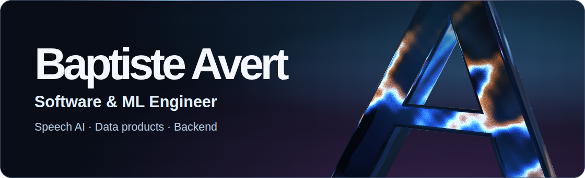
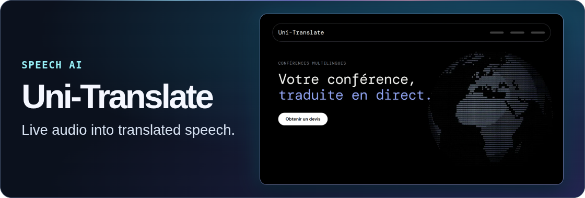
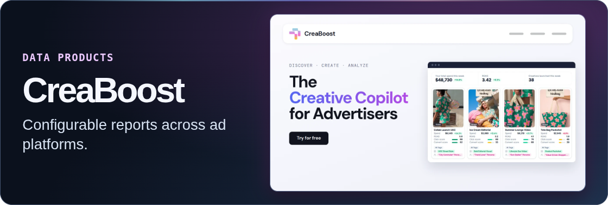
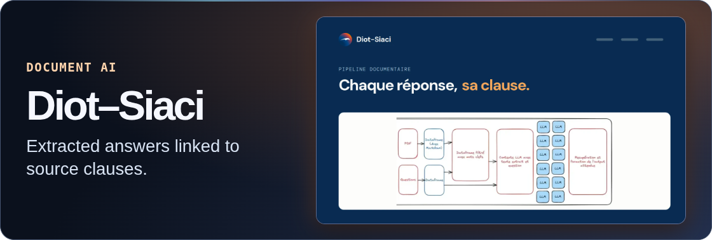
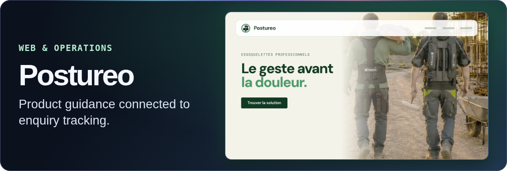
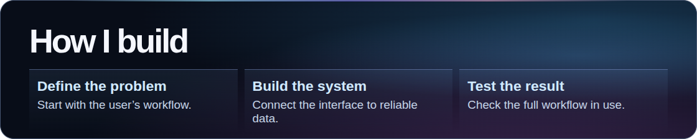
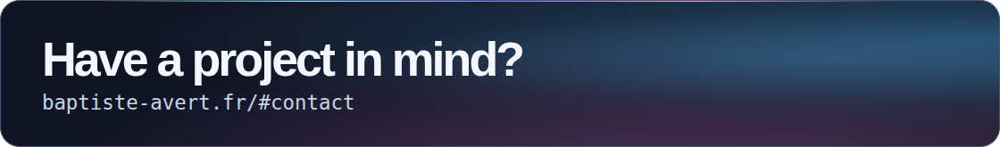

<a href="https://baptiste-avert.fr">
  <picture>
    <source media="(max-width: 600px)" srcset="./assets/prism-hero-mobile.png">
    
  </picture>
</a>

[Portfolio](https://baptiste-avert.fr/en) · [LinkedIn](https://www.linkedin.com/in/baptiste-avert) · [Contact](https://baptiste-avert.fr/#contact) · [Malt](https://www.malt.fr/profile/baptisteavert)

I build software for **live speech, document intelligence and data products**, from backend services to the user interface.

## Selected work

<a href="https://baptiste-avert.fr/projets/unitranslate?lang=en">
  <picture>
    <source media="(max-width: 600px)" srcset="./assets/case-unitranslate-mobile.png">
    
  </picture>
</a>

I co-founded Uni-Translate and work on streaming speech recognition, translation and synthesis, including the decision of when a segment is ready to be voiced.

<a href="https://baptiste-avert.fr/projets/creaboost?lang=en">
  <picture>
    <source media="(max-width: 600px)" srcset="./assets/case-creaboost-mobile.png">
    
  </picture>
</a>

I contributed to configurable dashboards, report sharing and permissions, and Playwright testing in GitLab CI.

<a href="https://baptiste-avert.fr/test41/projets/diot">
  <picture>
    <source media="(max-width: 600px)" srcset="./assets/case-diot-mobile.png">
    
  </picture>
</a>

I worked on a contract-analysis proof of concept that links extracted answers back to passages in the original PDF. [See the case study and pipeline diagram](https://baptiste-avert.fr/test41/projets/diot).

<a href="https://baptiste-avert.fr/projets/postureo?lang=en">
  <picture>
    <source media="(max-width: 600px)" srcset="./assets/case-postureo-mobile.png">
    
  </picture>
</a>

I worked on connecting the public exoskeleton guidance journey to a workspace for tracking customer requests.

Also shipped: [Les Abeilles de Victoire · immersive Web 3D](https://lesabeillesdevictoire.com/) · [Alter Finances · guided service](https://alter-finances-courtage.fr) · [This Astro + Three.js portfolio](https://baptiste-avert.fr)

## Technologies

| Area | Tools |
| :--- | :--- |
| Interfaces | TypeScript, React, Next.js, Astro, Three.js, WebGL |
| Backend & real time | Python, FastAPI, WebSocket, Java, C++, SQL |
| AI & data | PyTorch, ONNX Runtime, Triton, vLLM |
| Testing & operations | Playwright, GitLab CI, Sentry, PostHog, Cloudflare |

## Experience and education

- **CreaBoost · 2025–2026** · Product development, first as an intern and then freelance.
- **Diot–Siaci · 2024–2025** · R&D internship in generative AI and document analysis.
- **Sopra Steria · 2023** · Internship on France’s national health data infrastructure.
- **Epitech Paris · 2022–2027** · Five-year Grande École program. French state-accredited diploma and RNCP level 7 qualification in progress. Warm Up Days EIP winner with Uni-Translate.
- **Beijing Institute of Technology** · Computer science exchange.

[Explore all projects](https://baptiste-avert.fr/projets?lang=en)

<picture>
  <source media="(max-width: 600px)" srcset="./assets/prism-method-mobile.png">
  
</picture>

<a href="https://baptiste-avert.fr/#contact">
  <picture>
    <source media="(max-width: 600px)" srcset="./assets/prism-contact-mobile.png">
    
  </picture>
</a>
